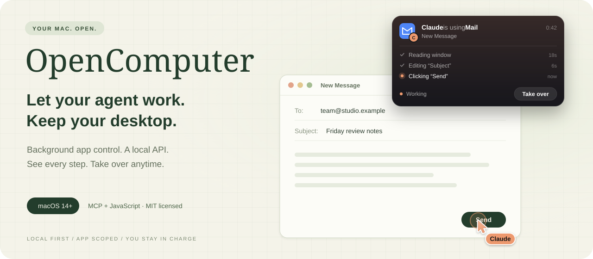
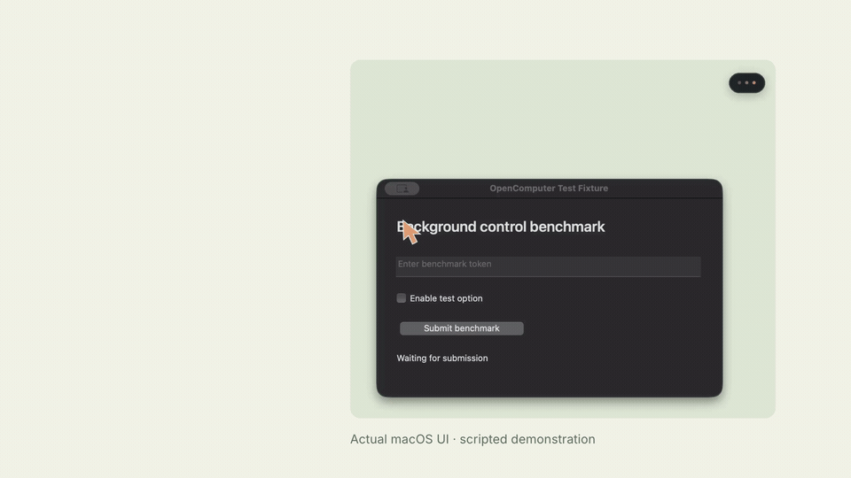
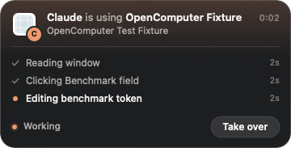
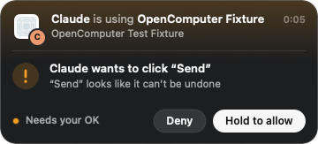

<p align="center"></p>

<p align="center"><a href="https://github.com/00cyre/opencomputer/releases/download/v0.3.0/OpenComputer-0.3.0-macOS.zip"></a></p>

<p align="center"><a href="#watch-it-work">Watch demo</a> · <a href="#get-started">Get started</a> · <a href="docs/INSTALL.md">Connect your agent</a> · <a href="docs/API.md">API reference</a> · <a href="docs/BENCHMARKS.md">Claude &amp; Grok benchmarks</a></p>

<p align="center">
<a href="https://github.com/00cyre/opencomputer/actions/workflows/ci.yml"></a>
<a href="LICENSE"></a>


</p>

**OpenComputer gives AI agents a local interface for working with Mac apps in the background.** Open and discover apps, read them as a compact outline, click, type, press keys, scroll, and capture a window — all without moving your pointer, taking keyboard focus, or bringing an app forward. Connect it to an MCP client or use the JavaScript API directly. No OpenComputer account, API key, cloud service, or npm dependencies.

## Watch it work

A 27-second showcase with narration, sound effects, and music. Click the preview to watch with sound.

[](https://github.com/00cyre/opencomputer/releases/download/v0.2.1/OpenComputer-Showcase-16x9.mp4)

[**Watch with sound · 27 seconds**](https://github.com/00cyre/opencomputer/releases/download/v0.2.1/OpenComputer-Showcase-16x9.mp4) · [Vertical social cut](https://github.com/00cyre/opencomputer/releases/download/v0.2.1/OpenComputer-Showcase-9x16.mp4) · [Editable Hyperframes projects](https://github.com/00cyre/opencomputer/releases/download/v0.2.1/OpenComputer-Showcase-Hyperframes.zip)

Actual native UI with choreographed demo actions. [Recording details](docs/SHOWCASE.md).

## Background control, visible activity

Inspired by the app-scoped workflow of [ChatGPT Computer Use](https://learn.chatgpt.com/docs/computer-use). This is an independent implementation using public macOS APIs. It is **not a drop-in replacement for OpenAI's private runtime**, and it does not provide ChatGPT's approval system or locked-Mac access.

| For your agent | For your desktop |
| :--- | :--- |
| Fourteen MCP tools with explicit input schemas. | Exact app allowlists, or explicit all-app access on your own Mac. |
| Compact outlines with element IDs that stay valid across actions. | Clicks are accessibility presses; keys go to the target process only. Your pointer never moves. |
| Window screenshots, including covered windows. | Captures are scoped to the selected app's window. |
| Native actions with verification metadata. | An app that brings itself forward is sent back; your foreground app is restored. |
| Clear refusals when the person takes over or declines. | Three dots open into a card with the agent's recent steps, **Take over**, and **Allow / Deny**; a named ghost cursor marks the target. |

## Get started

**macOS 14+ · Node.js 22+ · Apple Silicon or Intel**

1. **[Download the runtime ZIP](https://github.com/00cyre/opencomputer/releases/download/v0.3.0/OpenComputer-0.3.0-macOS.zip)** and extract it somewhere permanent. It includes the universal native helper; Node.js is installed separately.
2. In that folder, run `node bin/opencomputer.mjs doctor`. Approve Accessibility and Screen Recording for the launching host in **System Settings → Privacy & Security**, then restart that host if needed. [Permission help](docs/INSTALL.md#macos-permissions).
3. Add the MCP server to your agent using its documented configuration. Start with one app you intend to automate:

```json
{
  "mcpServers": {
    "opencomputer": {
      "command": "/absolute/path/to/node",
      "args": ["/absolute/path/to/opencomputer/bin/opencomputer.mjs", "serve"],
      "env": { "OPENCOMPUTER_APPS": "com.apple.TextEdit" }
    }
  }
}
```

Ask your agent to inspect a disposable TextEdit document. Have it read the current state before each action and check the result afterward. **Empty allowlist means no app access.** Use `node bin/opencomputer.mjs apps` to find bundle IDs. Set `OPENCOMPUTER_APPS` to `*` for explicit access to all running apps and their existing sessions; no VM or browser-profile copying.

> **Developer runtime:** the native helper is ad-hoc signed, not Apple-notarized. macOS may block downloaded binaries. Follow the normal macOS approval flow or [build from source](docs/DEVELOPMENT.md); OpenComputer never disables Gatekeeper. This release is a developer runtime, not a graphical installer.

[Checksums](https://github.com/00cyre/opencomputer/releases/download/v0.3.0/SHA256SUMS.txt) · [Claude and Grok setup](docs/INSTALL.md) · [Release notes](CHANGELOG.md)

## See what your agent is doing

A small **three-dot glass pill** sits at the top right while an agent has an app in use. Hover and it opens into a card: the app's icon badged with the agent, "Claude is using Notes", the window or browser-tab title, elapsed time, and the **last three steps** as a live timeline. Move away to collapse it. Multiple agents get separate, stacked indicators. Icons come from installed apps.



The ghost cursor wears the agent's colour and name tag, eases between targets, leans into its motion, and dips with a ripple when an action lands. It gently floats while idle. It appears at the agent’s target while that part of its window is visible. It follows window movement and disappears when covered, hidden, or minimized. Both overlays stay above ordinary windows, pass clicks through, and cannot become the active window. They never move your real pointer. The agent calls `release` when finished to remove them. [Behavior and settings](docs/ACTIVITY.md).

## Stay in charge

**Take over** on the card pauses the agent: its actions are refused with `PAUSED_BY_USER`, nothing is sent, until you press **Resume**. To approve consequential actions first, set `OPENCOMPUTER_CONFIRM`: `sensitive` asks before buttons like Send, Pay, or Delete and before Return; a bundle ID asks before everything in that app; `all` asks before every action. The card opens with **Deny** and **Allow**, and the agent is told to wait for you. [How it works](docs/ACTIVITY.md#approve-before-it-acts).



## Work alongside your agent

Whatever you do in other apps never blocks the agent. Only work in the same window does: an action then waits a couple of seconds for you to pause, with an amber indicator explaining why, and otherwise returns `USER_BUSY` with nothing sent. If an app brings itself forward when the agent presses something, OpenComputer hands the foreground back to the app you were in. [Signals, thresholds, and limits](docs/API.md#staying-out-of-the-persons-way).

## A familiar interface

```js
import { createComputer } from './src/computer.mjs';

const computer = createComputer({ apps: ['com.apple.TextEdit'], agent: 'Claude' });
try {
  const app = computer.getApp('com.apple.TextEdit');
  const state = await app.getAXState();
  const field = state.nodes.find(node => node.settable && node.role === 'AXTextArea');
  if (!field) throw new Error('No writable text area in this window');
  await app.setValue(field.id, 'Hello from OpenComputer');
  console.log(await app.getAXState()); // verify the result
} finally {
  computer.close();
}
```

Element IDs stay valid across actions until the next full observe of that app; one observe can drive a multi-step task. Stale IDs fail with a clear error. Screenshots can return a window-selection list; select the intended window and request it again. [Full API](docs/API.md).

## What works today

- **Background control:** pointer-free clicks on elements or screenshot points, writable values, secondary actions, and opening apps or URLs without activating them.
- **Window capture:** ScreenCaptureKit captures a selected window without capturing the whole desktop.
- **Agent connections:** local MCP over stdio, plus a JavaScript client with serialized requests and bounded timeouts.
- **Text, keys, and scrolling:** insertion at the caret, typed text and shortcuts delivered to the target process only, and page scrolling.
- **Fast reads:** batched attribute reads return a typical thousand-element window in well under a second, as a compact outline with `query` search.
- **Activity and focus protection:** hover-to-open activity card with a step timeline, visible-target ghost cursor, window-aware interaction checks, and foreground restoration when an app activates itself.
- **Take over and approvals:** pause any agent from the card, and approve sends, payments, posts, and deletes before they happen.
- **Any agent:** each MCP client runs its own server, so several agents can work at once.

**Not implemented:** hover, drag, right-click, pixel-exact clicks on canvases, browser DOM automation, Windows/Linux, and locked-screen operation. Canvas-only controls, minimized windows, secure fields, and apps with incomplete accessibility support may not work. Keys reach the target app's own focused control, and some apps ignore keys while in the background. An app can still bring itself forward for a moment before the foreground is handed back; public macOS APIs cannot prevent that. Each agent host needs its own Accessibility and Screen Recording approval. [Compatibility and acceptance checks](docs/TESTING.md).

## Quietly local

The server opens no network listener and sends no telemetry. It does not read browser profiles, store screenshots, or use the clipboard for text insertion. Your AI client may send tool output and screenshots to its model provider; that client's data policies apply. Accessible password values are redacted, but screenshots and ordinary text fields may still contain secrets.

The app allowlist is a process-level control, not a sandbox against an agent that can execute arbitrary shell commands. Your MCP client remains responsible for user consent, prompt-injection handling, and approval before consequential actions. [Privacy](PRIVACY.md) · [Security model](SECURITY.md)

## Tested with Claude and Grok

Both installed clients completed the native fixture task through OpenComputer 0.3.0: fill a field, enable an option, submit once, verify, capture a window, and release the indicators. Claude used 11 tool calls and Grok 14, with zero errors in their completed benchmark runs. Both preserved focus. Earlier Grok activity pauses and a turn-limit interruption are recorded alongside the passes. [Results, methodology, and limitations](docs/BENCHMARKS.md).

## Build, test, contribute

```sh
npm run build              # Swift helper, macOS only
npm test                   # protocol and client behavior
npm run check              # syntax, documentation links, release metadata
npm run fixture:build      # disposable native benchmark app
npm run test:integration   # real accessibility actions + window screenshot
npm run test:activity      # two agents, visibility, cleanup
npm run test:ui            # animated dots, hover, actual panel screenshots
npm run test:focus         # foreground restoration + two-window work
npm run test:interaction   # deterministic activity-conflict scenarios
```

[Developer guide](docs/DEVELOPMENT.md) · [Test coverage](docs/TESTING.md) · [Reproduce the AI benchmark](docs/BENCHMARKS.md) · [Report an issue](https://github.com/00cyre/opencomputer/issues)

---

<p align="center">Let your agent work. Keep your desktop.<br><a href="LICENSE">MIT licensed</a> · <a href="https://github.com/00cyre">00cyre</a></p>
