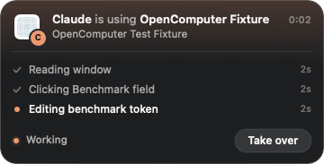
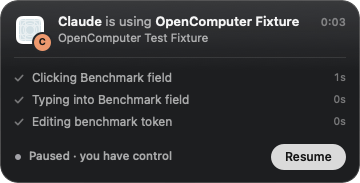
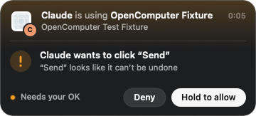

# Activity indicators

Enabled by default on macOS. Observation, screenshot capture, and actions start or update a session’s activity indicator. No extra service or login item is installed.

## Three dots that open into a card

The collapsed indicator is a 56 × 30 point glass pill with three dots in the agent's colour, placed at the top right of the primary display's usable area. Hovering opens it into a 360-point card that grows out of the dots in about a quarter of a second:

- **Who and where:** the target app's icon with the agent's icon as a badge, "Claude is using Notes", and the window or browser-tab title.
- **Steps:** the last three operations as a timeline. The current one pulses in the agent's colour, finished ones get a check, and each shows how long ago it started. A new step slides in from below. Elapsed time for the session sits at the top right.
- **Status and controls:** Working, Waiting for you (amber, with the reason as the current step), Paused, or Needs your OK, next to the buttons that apply: **Take over**, **Resume**, or **Deny** / **Hold to allow**.

Leaving the card closes it after a short delay. The glass follows the system's light or dark appearance. For a browser, the title comes from its accessibility window title, which commonly contains the selected tab name; this is not a browser DOM integration.

Screenshots above are from the real AppKit implementation using synthetic fixture data. Claude's icon was loaded from the installed app at runtime. No vendor icon assets are distributed separately. Unknown or uninstalled AI apps use an initial.

Each helper represents one session and its latest target app. Concurrent sessions stack their pills, and an open card pushes the pills below it down. Indicators remain until `release`, server exit, or target-app exit; they do not imply that the model is continuously dispatching an action. A paused focus guard stays visibly paused even after read-only inspection.

When a mutation conflicts with your input, the dots turn amber and the current step explains the wait: editing, clicking, scrolling, a held gesture, or a nearby pointer. The action was not dispatched or queued. A later fresh observation/action rechecks activity; the helper never replays the action by itself. If an app brings itself forward during an action, the foreground goes back to the app you were in (see [focus and settings](#focus-and-settings)). A request that fails after it started a step marks that step with a cross and a short reason, such as "the page changed".

## Take over

**Take over** pauses the session. Until you press **Resume** on the same card, every action and `open` from that agent is refused with `PAUSED_BY_USER` and nothing is sent; observing and screenshots still work, so the agent can see what you changed. The dots become two grey bars while paused. Resuming drops the session's snapshots, so the agent's next action answers `STALE_SNAPSHOT` and it has to look again at what you changed. The pause outlives `release`: an agent cannot end it by finishing its session, and if it tries to act again the card reappears with **Resume**. Each helper (each connected agent) has its own pause.

## Approve before it acts

Set `OPENCOMPUTER_CONFIRM` in the server's environment to have the card ask before consequential actions:

| Value | Asks before |
| --- | --- |
| `sensitive` | Clicks and presses on controls whose label contains a whole word such as Send, Pay, Buy, Order, Checkout, Post, Publish, Submit, Delete, Remove, Trash, Transfer, Confirm, or Subscribe, and before Return, Enter, and cmd+Delete. |
| a bundle ID, e.g. `com.apple.mail` | Every action in that app. |
| `all` or `*` | Every action. |

Entries combine with commas, for example `sensitive,com.apple.MobileSMS`. Unset or `off` asks for nothing.

The card opens by itself with "Claude wants to click “Send”" and the reason under the app and window it names, with **Deny** / **Hold to allow**. Allow counts only after you hold it for half a second (it fills as you hold); a quick click, sliding off, or anything other than your mouse does nothing. Take over, Resume, and Deny are also offered to VoiceOver as actions on the indicator; Allow deliberately is not, so no assistive or automation tool can grant permission on your behalf. The action waits up to about 15 seconds for your answer (less when the request also allows a long `waitMs`, so the whole request stays inside the client's 20-second timeout). Without an answer it returns `APPROVAL_PENDING` with nothing sent and the question stays up; when the agent retries the same call after you press **Allow**, it runs once. **Deny** returns `APPROVAL_DENIED`. An answer applies only to the exact action it was asked about, unanswered questions lapse after two minutes, and approvals nobody used lapse after one. The action log records `approved: true` on actions that ran after your OK.

Label matching is a heuristic, not an understanding of intent: a button named "Go" that pays will not be caught, and "Remove filter" will be asked about. Use per-app entries for apps where every action matters.

## Ghost cursor

The colored arrow marks the last targeted control, or a point near the window’s upper left during observation. It eases between targets over 220–500 ms with zero starting/ending velocity. After a brief pause it gently floats by up to 2.4 points vertically and 0.65 points horizontally, with a 2.4-second vertical cycle. These are visual offsets; the real pointer stays untouched. It follows the target window and appears only where that window is exposed. Covering that point, minimizing/hiding the window, or moving it offscreen hides the arrow. It reappears when the target is visible again. Accessibility hit-testing checks only the owner/window identity of the point; it does not read covering apps’ contents.

The arrow is a visual annotation. It does not move the real pointer and is not included in app-window screenshots returned to the agent.

## Focus and settings

Both panels use non-activating AppKit windows, cannot become key/main, and sit above ordinary app windows. The ghost cursor and the collapsed dots ignore mouse events; hover is read from the pointer location, so clicks keep reaching the window underneath. Only the fully open card takes clicks, for its buttons, and pressing one never activates OpenComputer or changes the foreground app. Take over, Resume, and Deny are also offered to VoiceOver as actions on the indicator. System/security UI can appear above them. Display/Space/full-screen combinations beyond the documented tests remain unverified.

MCP client identity is detected during initialization. To override it, set `OPENCOMPUTER_AGENT=Claude` or another display name in the server’s environment. Set `OPENCOMPUTER_OVERLAY=0` to disable both visuals; focus protection remains enabled. Without the card there is no Take over button, and actions that `OPENCOMPUTER_CONFIRM` covers fail with `APPROVAL_UNAVAILABLE` instead of waiting for an answer nobody can give. JavaScript equivalents are `{agent: 'Claude', overlay: false}`. Restart the server after configuration changes.

OpenComputer never activates an app for its own work or moves the pointer. Keys are posted to the target process only. An app can activate itself in response to an action; when the person did not cause it, the helper hands the foreground back to the app they were in. This cannot prevent a brief flash forward. See [staying out of the way](API.md#staying-out-of-the-persons-way).

For stacking, helpers exchange only PID, heartbeat time, expanded/collapsed state, and card height in a per-user temporary directory. No app names, window titles, action text, or input values are written there. Clean release removes the session record; records left by forced termination are ignored after the process dies or heartbeat expires.
