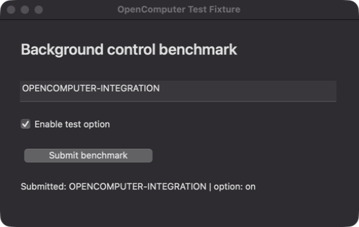

# Claude and Grok benchmark

## Measured results — 2026-11-06

Both installed AI clients completed the same task through OpenComputer's production MCP server and native helper.

| Client | Model reported by client | Result | Tool calls | Tool errors | End-to-end time |
| --- | --- | --- | ---: | ---: | ---: |
| Claude Code 2.1.316 | `claude-opus-5-5` | Pass | 10 | 0 | 33.23 s |
| Grok Build 1.0.62 | `grok-4.7-build` | Pass | 10 | 0 | 36.79 s |

**Each pass includes:** exact text value, checkbox enabled, exactly one submission, post-action observation, an actual screenshot image returned through MCP, and all three mutations performed while the fixture was in the background. Every mutation reported `focusChanged: false`. The fixture's independent state file confirmed the result. The Grok run also spanned a human foreground-app switch outside the actions, which is expected during background use.

Environment: macOS 27.2, Apple Silicon (`arm64`), Node 25.9.0, Swift 6.1.2. Eight unit tests and thirteen real macOS integration assertions passed. Intel compilation/signature checks passed; Intel hardware execution was not tested. The supported minimum macOS version is a build target, not a claim that the entire OS range was exercised.

Two earlier functional repetitions per client also completed successfully. The table reports only the final instrumented run per client, after adding an explicit check that the target was not frontmost during actions. This is a small smoke benchmark: do not interpret the timing difference as a model ranking. Initial setup attempts were blocked by expired Claude authentication and Grok project/session configuration; those were resolved before the measured runs.

[Machine-readable results](benchmark-results.json). Raw client transcripts, account information, current app names, and authentication material are excluded from published evidence.



The screenshot shows only the disposable fixture, with a synthetic integration-test token. It is captured through the production window-capture code, not a mockup.

## Reproduce

Build the helper and fixture, then use clients that are already installed and signed in:

```sh
npm run build
npm run fixture:build
node scripts/benchmark.mjs claude ./work/bench-claude
node scripts/benchmark.mjs grok ./work/bench-grok
```

Run serially on an unlocked Mac with Accessibility and Screen Recording. You may use other apps while the run executes. The benchmark never changes an existing AI chat.

The identical task is to enter `OPENCOMPUTER-BENCH-2026`, turn on the test checkbox, submit exactly once, verify the visible result, and capture the named test window. Only `cc.opencomputer.fixture` is allowed. The model is instructed to use only OpenComputer tools.

The controller checks the fixture's own state, tool errors, an actual MCP image response, focus changes during each action, that the target was not frontmost before or after any mutation, and that the fixture was not frontmost at submission. The separate foreground-stability field records app switches across the entire run and is not a pass criterion, since the human may keep working. The fixture state file is not offered to the model. `result.json` is independent of any success claim in the model's prose. The audit records method names/status/timing, never raw images or accessibility values.

Claude uses a strict per-invocation MCP config. Grok uses a separate `GROK_HOME` and leader socket, reusing the installed client's auth file locally. Neither edits your existing MCP servers. Grok may create local runtime/session files in that isolated directory. The original account credentials never enter the repo or release. Remove the isolated benchmark directory when finished; it may contain a local auth symlink or refreshed client credential file. Logs and model responses stay in `work/`; review/redact before sharing.

This is a small integration benchmark, not an intelligence leaderboard or a statistically meaningful speed comparison. Timing includes client startup, MCP startup, model inference, and actions. Default models, account tiers, network conditions, and caches can differ. Results apply to the native test fixture, not all macOS apps or parity with ChatGPT.
